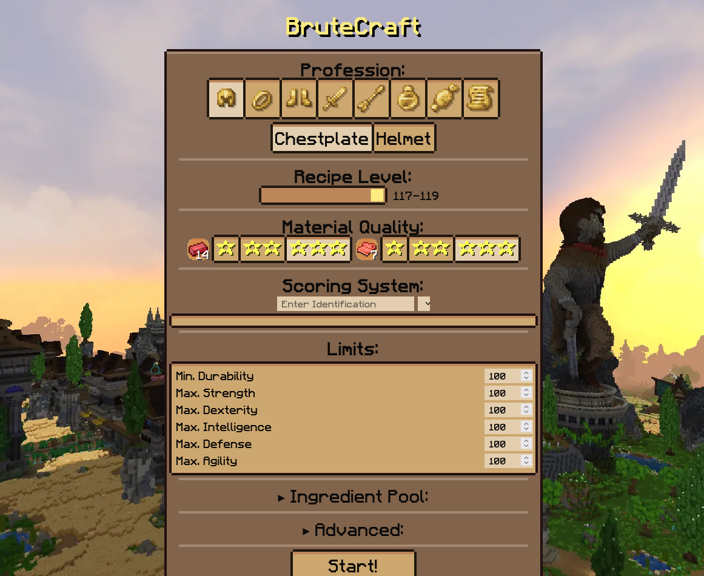

# BruteCraft

BruteCraft is a static web app tool that runs a **genetic-style search** using [WynnCraft ingredients](https://wynncraft.com/help/item-guide) to find theoretical best recipes that fit various criteria. Weigh identifications, set limits, durability requirements, which ingredients to consider and how many iterations to run. Preview recipe, stats and a WynnBuilder link.

Generation is strictly client-side and you can run it on any device. BruteCraft is widely used within the community to find and confirm best-fit crafting recipes.

> Try the tool here: https://brutecraft.warze.org

